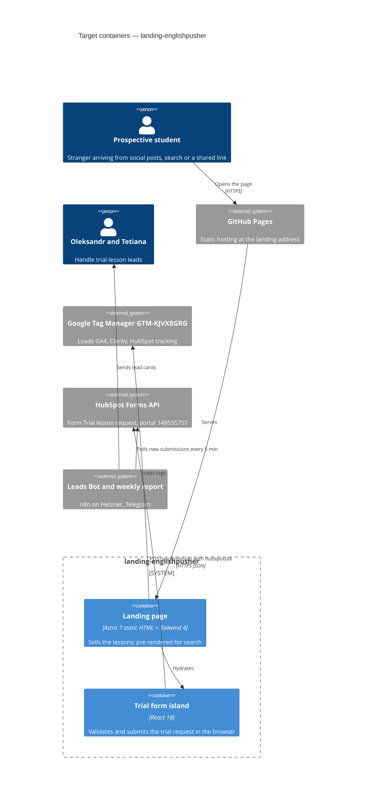

# Architecture map — landing-englishpusher

> The **target foundation** for an empty repo, fixed by `survey` (greenfield) on 2026-10-30 with
> the owner, and read by specify / design / implement. `scaffold` turns it into a real skeleton;
> re-run `survey` afterwards so the map describes the code that exists. No hand-maintained
> architecture doc exists.

Intent (from [`docs/idea-brief.md`](idea-brief.md), confirmed): one public, static marketing
page that sells Tetiana's English lessons to strangers (IT/office professionals and general
adults) and turns them into trial-lesson requests in the existing HubSpot pipeline. It lives at
its own address; the Moodle site `englishpusher.in.ua` is untouched.

## Stack

- Language / runtime: TypeScript, Node **>= 22.23.4** (Astro 7's engine requirement, `npm view
  astro@7 engines`, checked 2026-10-30) — [ADR-0001](adr/0001-astro-static-site-with-react-island.md)
- Frameworks (versions current on npm 2026-10-30):
  - `astro` 7.4.x, static output (pre-rendered HTML)
  - `@astrojs/react` 7.1.x with `react` / `react-dom` **18** (same major as `app-englishpusher`, so
    its form component can be copied as is)
  - `tailwindcss` 4.3.x via `@tailwindcss/vite` (Tailwind 4's CSS-first config; the legacy
    `@astrojs/tailwind` integration is not used)
  - `@astrojs/check` 0.9.x for type checking `.astro` files
- Build / test / lint (scripts the scaffold creates):
  - `npm run build` → `astro build` → `dist/`
  - `npm test` → `node --test "src/**/*.test.ts"` (Node's own test runner with type stripping, the
    convention of `D:\VIBE CODING\app-englishpusher\package.json` `scripts.test`)
  - `npm run check` → `astro check` (types + `.astro` diagnostics; there is no separate linter,
    matching the app)
- Deploy: GitHub Actions on push to `main` → GitHub Pages —
  [ADR-0002](adr/0002-host-on-github-pages-via-actions.md)

## C4 — target foundation

## Module inventory

Target layout; nothing exists yet.

| Module | Path | Layers | Wired at | Responsibility |
|---|---|---|---|---|
| Page | `src/pages/index.astro` | page | Astro file-based routing | The landing page, composed of sections |
| Layout | `src/layouts/BaseLayout.astro` | layout | imported by every page | `<head>`: meta/SEO, fonts, GTM snippet, global CSS |
| Sections | `src/components/` | ui (`.astro`) | imported by `index.astro` | Static page sections (hero, about, offer, testimonials, FAQ…), content decided in `specify` |
| Trial form | `src/components/trial-form/` | ui (React island) | `<TrialDialog client:idle />` in `index.astro`, opened by `#trial-lesson` links | Dialog shell + form UI and states, copied from the app |
| Form logic | `src/lib/` | pure TS | imported by the trial form | `hubspot.ts`, `validate.ts`, `options.ts`, each with `*.test.ts` |
| Styles | `src/styles/global.css` | tokens | imported by `BaseLayout.astro` | Tailwind 4 import + `@theme` brand tokens |
| Static files | `public/` | assets | served as-is | Images, favicon (`CNAME` is written by the deploy workflow) |

## Conventions (the rules a new feature must match)

- **Module wiring / registration:** pages are files under `src/pages/` (Astro routing); React
  only where interactivity is needed, as an island with `client:idle` ([ADR-0002](features/landing-page/adr/0002-open-trial-dialog-island-via-trial-lesson-hash-links.md)). Everything else is
  static `.astro` — [ADR-0001](adr/0001-astro-static-site-with-react-island.md).
- **Error handling:** the form never loses typed answers. On a failed submit it shows a fallback
  message with a contact link and keeps the values. Precedent:
  `D:\VIBE CODING\app-englishpusher\src\shared\trialForm\TrialForm.tsx`.
- **IDs:** none; there is no stored data.
- **Persistence / DB access:** none. Leads go from the browser to the HubSpot Forms API —
  [ADR-0003](adr/0003-no-backend-leads-via-hubspot-forms-api.md).
- **Migrations:** none (no datastore).
- **Tests:** pure logic in `src/lib/*.ts` with sibling `*.test.ts`, run by `node --test` —
  precedent `D:\VIBE CODING\app-englishpusher\src\shared\trialForm\hubspot.test.ts`. UI and
  integration with HubSpot are checked by a manual end-to-end submit (as done for the app on
  2026-10-24). A clean `npm run build` plus `npm run check` is the skeleton smoke test.
- **Inter-module communication:** direct imports only.
- **Tracking:** the GTM container `GTM-KJVX8GRG` is loaded in `BaseLayout.astro`. Code pushes
  `dataLayer` events with the app's names: `trial_form_open` and `generate_lead` (`form_name:
  trial_lesson`), pushed after HubSpot confirms — precedents
  `D:\VIBE CODING\app-englishpusher\src\shared\TrialLessonForm.tsx:35` (`trial_form_open`) and
  `src\shared\trialForm\TrialForm.tsx:135` (`generate_lead`) in the same repo.
- **Code shared with the app:** copied, not shared as a package. A copied file keeps a header
  comment naming its source path in `app-englishpusher`.
- **UI / styling:** Tailwind 4 utility classes with the brand tokens below; no other CSS approach.

## Datastores

| Store | Engine | Accessed via | Notes |
|---|---|---|---|
| (none in this repo) | — | — | Leads live in HubSpot (external): form `2226dfee-47d4-406f-ae1a-2e8c0952dec2`, portal `149535757`, region eu1 |

## Frontend / UI foundation

- **Component library / design system:** none yet. Sections are built in `src/components/` with
  Tailwind. The visual reference is the app's look — `D:\VIBE CODING\app-englishpusher\src\Index.tsx`.
- **Design tokens:** to be defined in `src/styles/global.css` `@theme`, ported from
  `D:\VIBE CODING\app-englishpusher\tailwind.config.js` and `src\index.css`:
  `--color-brand: #f07c1a`, `--font-display: "Space Grotesk"`, `--font-body: Inter`, page
  background `#faf8f5` (warm cream).
- **Styling approach:** Tailwind 4 via `@tailwindcss/vite`.
- **Shared primitives:** none yet; the first ones (button, section container) appear with the
  first feature.
- **State / data-fetching:** React local state inside the form island only.
- **Closest UI precedent:** the trial form —
  `D:\VIBE CODING\app-englishpusher\src\shared\trialForm\TrialForm.tsx` (modal card, level pills,
  goal chips, thank-you screen with confetti, Tetiana avatar).

## Where things live / closest precedents

- A new page section → `src/components/<Name>.astro`, added to `src/pages/index.astro`.
- An interactive widget → a React component in `src/components/<name>/`, hydrated with
  `client:idle` (ADR-0002), with its logic in `src/lib/` and covered by `node --test`.
- The trial form → port of `app-englishpusher/src/shared/trialForm/` (`TrialForm.tsx`,
  `hubspot.ts`, `validate.ts`, `options.ts` and their tests).

## Constraints & known tech-debt

- **Node version:** Astro 7 needs Node >= 22.23.4; this machine had v22.20.0 on 2026-10-30.
  Upgrade local Node (e.g. the current 24 LTS) before `scaffold`. CI pins its own version.
- **Leads must keep flowing into the existing HubSpot form "Trial lesson request"** with the
  `hubspotutk` cookie and page URL, so the Leads Bot, the deal pipeline and the Monday report keep
  working (brief §5).
- **Tracking stays in GTM `GTM-KJVX8GRG`**; no separate GA4/Clarity snippets.
- **Address: `landing.englishpusher.in.ua`** (owner decision 2026-10-30, roadmap D3). The deploy
  workflow publishes with `cname:`; it needs a DNS `CNAME` record `landing` →
  `tauruskin.github.io` at the `englishpusher.in.ua` registrar. Moodle on the apex is untouched.
- **Duplicated form code** with `app-englishpusher` (by decision, ADR-0003): a change to the
  HubSpot fields must be made in both repos.
- **Content is blocked on Tetiana** (brief outcome `needs-evidence`): the foundation does not
  depend on it, but `specify` should wait for her answers and the UTM traffic test.

## Reconciliation with the authored architecture doc

No authored architecture doc; this map is the current reference.
