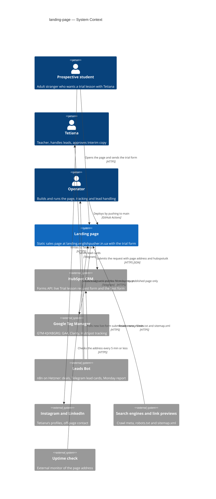
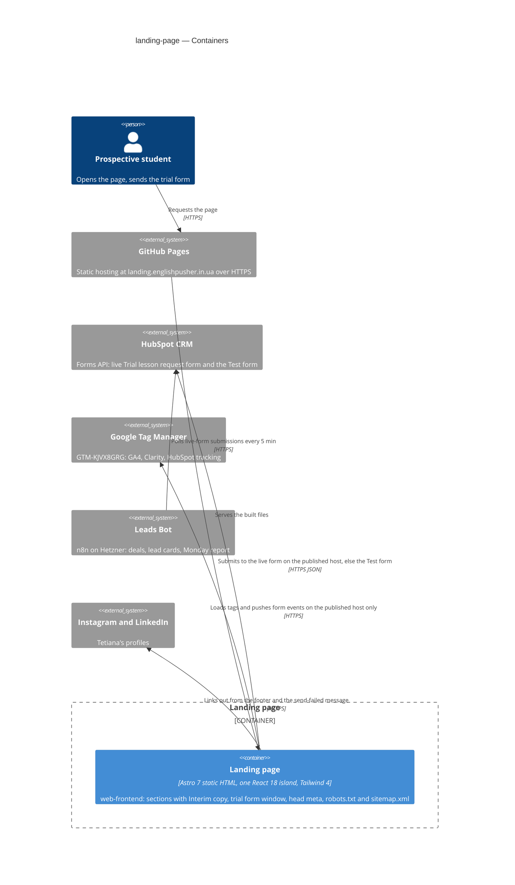
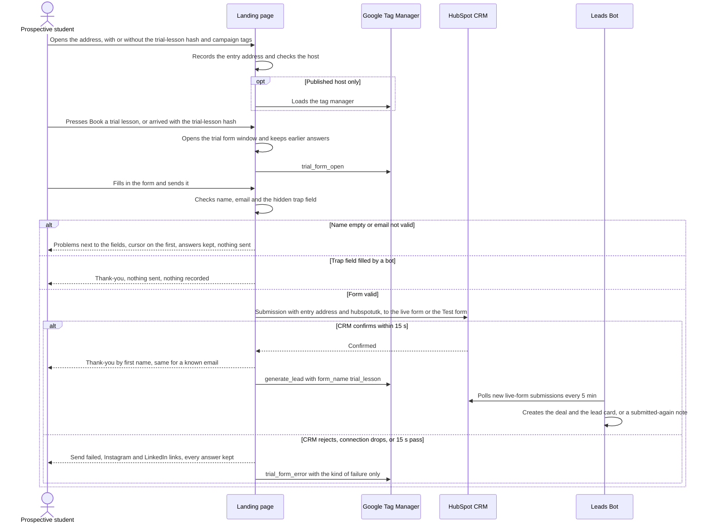
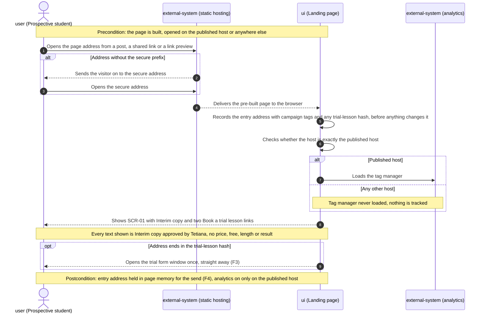
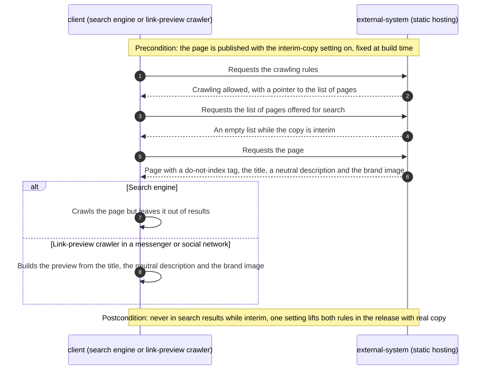
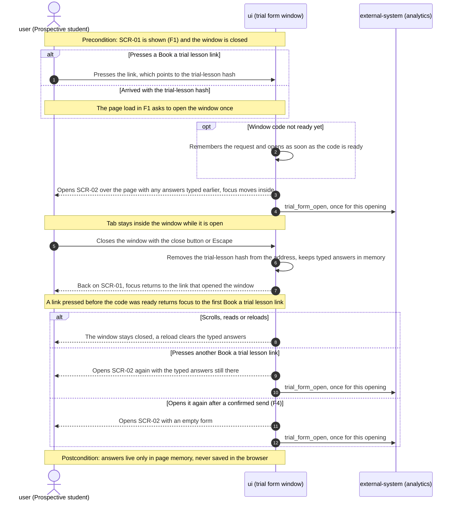
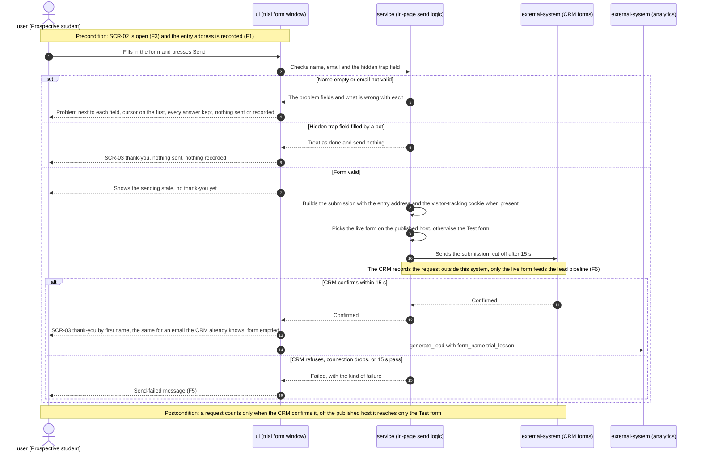
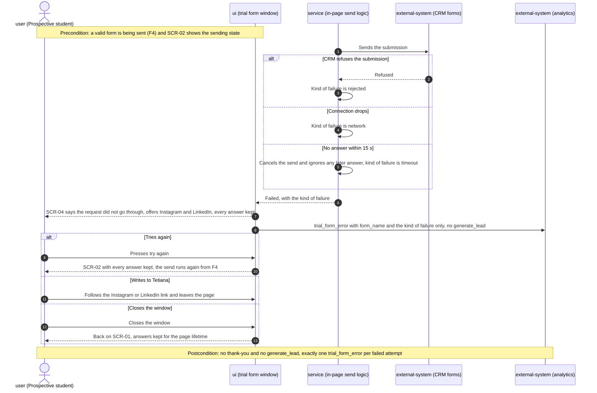
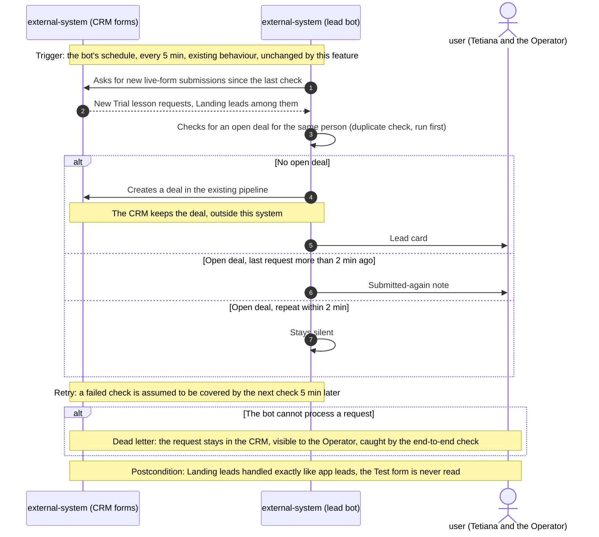

# Software Architecture Document — landing-page

<!-- 12 Arc42 sections. Empty section → <!-- N/A: <one-line reason> -->. -->
<!-- C4 Context (L1) lives inline in §3. C4 Container (L2) lives inline in §5. -->
<!-- Numbers in §10 come VERBATIM from spec.md §6 NFR — no inventing, no rounding. -->

## 1. Introduction and goals

**Intent.** The Landing page is a public, static sales page at `landing.englishpusher.in.ua` that
turns Prospective students into Trial lesson requests in the existing CRM pipeline (deal, Leads Bot
card, Monday report), through the same trial form the app already uses. This SAD covers only the
**sales skeleton** from spec §1: a page frame with Interim copy, the one trial form window, the
switch that keeps everything except the published page away from the live CRM form and analytics,
the page address that marks each Landing lead, and the search / link-preview data with indexing
closed while the copy is interim. Sales content is a separate feature (roadmap step 3).

**Top-3 quality goals (1-liners; full scenarios in §10):**

1. **Lead integrity:** every send gets a thank-you or a failure message within 15 s, a confirmed
   request reaches the Leads Bot within 10 min, a failed one is counted and keeps every typed
   answer, and no send from outside the published page reaches the live pipeline.
2. **Mobile page speed:** largest content shown ≤ 2.5 s at p75 and a mobile performance score ≥ 90,
   even though the page carries a React island and the tag manager.
3. **Accessible trial form:** usable by keyboard alone and by a screen reader, Lighthouse
   accessibility ≥ 95 with 0 serious or critical issues.

**Stakeholders.**

| Role | Interest | Sign-off owner? |
|---|---|---|
| Prospective student | Sends a Trial lesson request without losing typed answers; reaches Tetiana when sending fails | No |
| Tetiana | Gets Landing leads as the usual Leads Bot card and deal; approves all Interim copy before the page is published (AC-10) | Yes (Interim copy) |
| Operator | Builds and runs the page, its tracking, the Test form and the lead handling; counts Landing leads and lost sends | No |
| Tech Lead (the Operator acts as Tech Lead) | SAD approval | Yes |

<!-- Decision overrides (¶4) — populated by the critic resolution loop, empty otherwise. -->

- Decision override: focus return before hydration — rationale: ADR-0002 keeps a "Book a trial
  lesson" link pressed before the island hydrates from being lost, but the island cannot know which
  link it was, so focus then returns to the first such link instead of the pressed one (spec §6
  Accessibility). Accepted by the Operator 2026-10-31; checked in the screen-reader pass (§10 QG-3).

## 2. Constraints

**Technical.**
- TypeScript on Node **>= 22.23.4** (`.nvmrc` pins 24 LTS; CI reads it).
- Astro **7.4.x**, `output: "static"` (pre-rendered HTML), `site: https://landing.englishpusher.in.ua`
  (repo ADR-0001).
- `@astrojs/react` **7.1.x** with React / React DOM **18.3** (same major as `app-englishpusher`, so
  its form can be copied).
- Two runtime dependencies copied along with the app's form: `lucide-react` (icons) and
  `canvas-confetti` (the thank-you confetti).
- Tailwind **4.3.x** via `@tailwindcss/vite`, brand tokens in `src/styles/global.css` `@theme`
  (`brand`, `cream`, `font-display`, `font-body`).
- No datastore and no backend: the browser posts to the HubSpot Forms submission API (public, no
  key), portal `149535757`, region eu1, live form `2226dfee-47d4-406f-ae1a-2e8c0952dec2` (repo
  ADR-0003).
- Hosting: GitHub Pages, published by `.github/workflows/deploy.yml` (`npm test` →
  `npm run check` → `npm run build` → `peaceiris/actions-gh-pages@v4`, `cname:
  landing.englishpusher.in.ua`) (repo ADR-0002). No server-side code, so every rule below runs in
  the browser or at build time.
- Tracking only through GTM `GTM-KJVX8GRG`, loaded in `src/layouts/BaseLayout.astro`; no separate
  GA4 / Clarity snippets.

**Organisational.**
- Size S, about one week of work (spec §1 override); accepted as lost if roadmap D1 or D2 comes
  back negative.
- One maintainer, the Operator. Tetiana approves every piece of Interim copy before publishing.
- No hard deadline: publishing waits for the copy approval; launch (bio and post links) is roadmap
  step 6.

**Conventions.**
- [`CLAUDE.md`](../../../CLAUDE.md) and [`docs/architecture-map.md`](../../architecture-map.md)
  §Conventions: static `.astro` sections by default; React only as an island; logic in
  `src/lib/*.ts` with a sibling `*.test.ts` run by `node --test`; UI and the HubSpot integration
  checked by a manual end-to-end send.
- Code copied from `app-englishpusher` stays a copy (not a package) and keeps a header comment
  naming its source path; a HubSpot field change is made in both repos.
- `dataLayer` event names follow the app: `trial_form_open`, `generate_lead` (`form_name:
  "trial_lesson"`), pushed only after HubSpot confirms.
- No IDs, no migrations, no stored data.
- Override (see §4 and §11): the trial form window cannot hydrate with `client:visible`, the
  example in `CLAUDE.md`, because a closed window is never "visible" and AC-04 opens it as the page
  loads. Its hydration is a §4 decision.

**Regulatory / external.**
- The form carries personal contact data (spec §6.1, confidential). Nothing is stored in the
  browser; analytics events carry no personal data; the data goes only to the existing HubSpot
  portal (EU region).
- A personal-data notice on the form is an open question shared with the app (spec §8; §11 here).
  Default now: none, as in the app.
- Security review: N/A per spec §6.1 (same fields, same CRM form, no new access boundary).

## 3. Context and scope

A Prospective student reaches the Landing page from a social post, a shared link or (later) search,
and sends a Trial lesson request through the trial form. The page has no server: the request goes
from the browser straight to the existing HubSpot form, where the Leads Bot picks it up exactly as
it does for the app. Analytics load through the existing tag manager, and only on the published
page. Everything Tetiana does with a lead happens outside this system.

<!-- brownfield: scaffold skeleton only (BaseLayout with GTM, an empty index.astro, global.css brand tokens, deploy workflow); docs/architecture-map.md reflects 43e8506, the scaffold commit 022bedb and the address change 080f5f6 followed, read directly instead of re-scanning. The trial form precedent is app-englishpusher/src/shared/TrialLessonForm.tsx and trialForm/. -->

**External systems (in / out):**

| Actor or system | Type | Interaction |
|---|---|---|
| Prospective student | Person | Opens the page or a shared link (with or without `#trial-lesson`), sends the trial form, follows the Instagram / LinkedIn links |
| Tetiana | Person | Receives Leads Bot cards and deals; approves Interim copy (outside the page) |
| Operator | Person | Builds and deploys the page, runs the end-to-end check, reads analytics and the uptime check |
| HubSpot CRM (Forms API) | System (external) | Receives submissions: the live "Trial lesson request" form from the published page only, the Test form from everywhere else |
| Google Tag Manager `GTM-KJVX8GRG` | System (external) | Loaded only on the published page; carries GA4, Clarity and the HubSpot tracking code that sets `hubspotutk`; receives `dataLayer` events |
| Leads Bot (n8n on Hetzner) | System (internal, outside this repo) | Polls the live HubSpot form every 5 min, creates the deal and the Telegram lead card |
| Instagram and LinkedIn | System (external) | Off-page contact links in the footer and the send-failed message |
| Search engines and link-preview crawlers | System (external) | Read the page meta, `robots.txt` and `sitemap.xml`; asked not to index while the copy is interim |
| Uptime check | System (external) | Requests the page address every ≤ 5 min (tool in §7) |

**C4 Context (L1):**



## 4. Solution strategy

**Target surface:** `web-frontend` only (frontmatter `target_surfaces`). Every actor that uses the
page is a person in a browser. There is no `backend-service` (repo ADR-0003: the browser posts to
HubSpot directly) and no `worker` (the Leads Bot that polls HubSpot lives outside this repo).
**UI architecture:** pre-rendered static HTML with one React 18 island, inherited from repo
ADR-0001; no client-side router and no state library, only React local state inside the island.
How that island is hydrated and opened is the feature-level refinement in ADR-0002.

**Top strategic choices (the seeds for ADRs):**

1. **The browser decides "published" by an exact host match** ([ADR-0001](adr/0001-choose-live-form-and-analytics-by-exact-runtime-host.md)).
   One constant, `LIVE_HOST = "landing.englishpusher.in.ua"`, drives both the live-vs-Test form ID
   in the trial form and whether the inline head script loads the tag manager. A build-time switch
   alone cannot meet AC-13, because the production build opened anywhere else must behave as not
   published. Serves quality goal 1 (no test send in the live pipeline) and spec §6.1.
2. **One trial-form island, opened by `#trial-lesson` links, hydrated when the browser is idle**
   ([ADR-0002](adr/0002-open-trial-dialog-island-via-trial-lesson-hash-links.md)). Every "Book a trial
   lesson" button is a plain link to `#trial-lesson`, the same address a shared link uses (AC-04), so
   buttons and deep links share one mechanism, and a click before hydration is not lost. One island
   holds the form for the page lifetime, which keeps typed answers across openings (AC-03). Serves
   quality goals 2 (React does not compete with the first paint) and 3 (one dialog with one focus
   model).
3. **The page address sent with each request is the address the visitor arrived at.** An inline
   script at the top of `<head>` records `location.href` in page memory before anything can change
   the address; the form sends that value as the page address, plus `hubspotutk` when the cookie
   exists (AC-07). This is what makes each request a Landing lead without new CRM fields (spec §3).
4. **One setting marks the copy as interim.** `INTERIM_COPY` in `src/lib/site.ts` drives the
   `noindex` robots meta and the page's absence from `sitemap.xml`; `robots.txt` always allows
   crawling and points to the sitemap (AC-11). The release that replaces the Interim copy flips
   this one value.

Each tactical decision below traces to one of these four. Everything else is inherited from the
repo: static hosting (repo ADR-0002), no backend and copied form code (repo ADR-0003).

## 5. Building block view

Static by default, as the repo's convention requires: the page and its sections are `.astro` files
rendered at build time, the only client code is one React island plus one small inline script, and
all logic that can be tested without a browser sits in `src/lib/` as pure functions with sibling
`*.test.ts` files. The form code is copied from `app-englishpusher` (header comment naming the
source path) and changed only where spec §1 lists a deliberate difference.

**Internal decomposition:**

```
src/
├── pages/
│   ├── index.astro               the page: Hero, InterimBlock, Footer + <TrialDialog client:idle />
│   ├── robots.txt.ts             robots.txt built from lib/seo.ts (always allows crawling, names the sitemap)
│   └── sitemap.xml.ts            sitemap.xml built from lib/seo.ts (empty while INTERIM_COPY)
├── layouts/
│   └── BaseLayout.astro          <head>: entry-address script, host-gated GTM, title/description,
│                                 robots meta, Open Graph + Twitter card, lang="en"; no <noscript> GTM
├── components/
│   ├── Hero.astro                headline + "Book a trial lesson" link (#trial-lesson)
│   ├── InterimBlock.astro        one short interim block + second link
│   ├── Footer.astro              Instagram and LinkedIn links
│   └── trial-form/
│       ├── TrialDialog.tsx       the window: open on #trial-lesson or link click, close, remove hash,
│       │                         focus trap and return, trial_form_open
│       └── TrialForm.tsx         copied form: fields, validation, sending state, thank-you,
│                                 send-failed message with Instagram + LinkedIn, trial_form_error
└── lib/
    ├── site.ts (+ test)          LIVE_HOST, isPublished(host), form IDs (live + Test), INTERIM_COPY
    ├── seo.ts (+ test)           robots meta value, robots.txt and sitemap.xml bodies from INTERIM_COPY
    ├── hubspot.ts (+ test)       copied: buildSubmission (entry address, hubspotutk), 15 s cut-off,
    │                             failure kind (rejected | network | timeout)
    ├── validate.ts (+ test)      copied: name and email rules
    ├── options.ts (+ test)       copied: level and goal values pinned to the app (field parity),
    │                             Instagram and LinkedIn addresses
    └── events.ts (+ test)        dataLayer payloads: trial_form_open, generate_lead, trial_form_error
                                  (form_name + error_kind only, no personal data)
public/
├── og-image.png                  1200×630 brand image for link previews
├── teacher-trial.png             copied from the app: Tetiana waving, form header
└── teacher-celebrate.png         copied from the app: thank-you picture
```

**C4 Container (L2):**



## 6. Runtime view

**Critical flow 1: send a trial lesson request** (US-01, US-02, US-03, US-06; error branches inline;
the `sequences` stage maps every AC).



Off the published host the same flow runs, but the tag manager is never loaded (events go into an
unread `dataLayer` array) and the submission goes to the Test form, which the Leads Bot does not
read (AC-13; §11 tracks the check that this holds).

**Critical flow 2: async event propagation** — N/A: the only async step is the Leads Bot's polling,
which lives outside this repo and is unchanged (AC-06).

**Runtime flows by user story** (`sequences` stage). Participants are generic roles: *user* (the
Prospective student), *ui* (the page and its trial form window), *service* (the in-page send logic
in `src/lib/`), and *external-system* (static hosting, the CRM, analytics, the lead bot, a
crawler). There is no *data-store*: nothing is persisted, so no flow carries a persist step.
Screen ids follow [ux-flows.md](ux-flows.md).

### F1. Open the page



### F2. Search engines and link previews read the page



### F3. Open, close and reopen the trial form window



### F4. Send a trial lesson request



### F5. Sending fails, then try again



### F6. A confirmed request reaches the lead pipeline (async, outside this repo)



**Coverage (spec §4 user stories and §5 acceptance criteria → flows):**

| Story | Flows |
|---|---|
| US-01 Send a trial lesson request | F4 (failure path in F5) |
| US-02 Reach one form from anywhere | F3 (deep-link start in F1) |
| US-03 Keep answers when sending fails | F5 |
| US-04 Handle landing requests as usual | F6 |
| US-05 No unapproved promises | F1 (copy note) |
| US-06 Recognise and count landing leads | F1 (entry address, analytics gate), F4 (submission contents, live or Test form) |
| US-07 Own address, closed to search | F1 (secure redirect), F2 |

| AC | Shown by |
|---|---|
| AC-01 | F4, branch "CRM confirms within 15 s" |
| AC-02 | F4, branch "Name empty or email not valid" |
| AC-03 | F3, open, close, reopen and after-send branches |
| AC-04 | F1 opt "Address ends in the trial-lesson hash" + F3 (hash removed on close, no reopen) |
| AC-05 | F5 |
| AC-06 | F6 |
| AC-07 | F1 (entry address recorded first) + F4 (sent with the submission, cookie when present) |
| AC-08 | F4, trap-field branch and sending state; F5, no generate_lead |
| AC-09 | F4, confirm branch (same thank-you for a known email) |
| AC-10 | F1, copy note. N/A for the rest: Tetiana's approval of the copy is a check before publishing, not a runtime step |
| AC-11 | F2 |
| AC-12 | F1, branch "Address without the secure prefix" + F2, link-preview branch |
| AC-13 | F1, analytics gate + F4, live or Test form choice |

**Flagged by `sequences` (for design and the Operator, not decided here):**

- F6 rests on two unverified assumptions about the Leads Bot: it reads only the live form, and a
  failed check is picked up by the next one. Both are checked in the n8n workflow before
  `/sdd:tasks landing-page` (spec §8, §11 High risk).
- F5: after a timeout the CRM may still have received the request, so "try again" can create a
  second submission. The Leads Bot's duplicate check (F6) absorbs it. No change needed, noted for
  the end-to-end check.
- The design block "Critical flow 2: async event propagation — N/A" above predates F6. It is left
  unchanged (additive rule): F6 draws the external async step for coverage only, and nothing in
  this repo is async.
- No flow persists anything (no data-store), so no schema change and no index hints for
  `data-model`. All participants are already declared in §3 and §5. No new ADR candidates.

## 7. Deployment view

The page is a set of static files built by `.github/workflows/deploy.yml` on every push to `main`
and published to GitHub Pages (`gh-pages` branch, `cname: landing.englishpusher.in.ua`). GitHub
Pages serves them from its own CDN; there are no replicas, servers or scaling settings to manage.
The deploy workflow is unchanged; what this feature adds is one-time setup outside the code:

- DNS `CNAME` record `landing` → `tauruskin.github.io` at the `englishpusher.in.ua` registrar.
- GitHub Pages "Enforce HTTPS" switched on, so the insecure address redirects to the secure one
  (AC-12).
- HubSpot: the Test form, with the same fields as the live form; its ID goes into `src/lib/site.ts`
  (spec §8).
- Leads Bot: confirmed (or limited) to read only the live form (spec §8).
- GTM: GA4 event tags for `trial_form_open` and `trial_form_error` (spec §6 Lost sends, §7 Form
  completion).
- n8n uptime workflow on the Operator's Hetzner instance (below).

**Monitoring:**
- **Uptime:** an n8n workflow on Hetzner requests `https://landing.englishpusher.in.ua/` every
  5 min and counts the check as up when the answer is a success status and contains the page title.
  Each result is appended as one row to a log (a Google Sheet), and the monthly uptime is up-checks
  ÷ all checks. Two failed checks in a row send a Telegram alert to the Operator.
- **Lost sends:** GA4 `trial_form_error` ÷ (`generate_lead` + `trial_form_error`) per calendar
  month, read by the Operator, first read 30 days after publishing (spec §7).
- **Page speed:** Clarity Core Web Vitals filtered to the Landing page's host; a mobile Lighthouse
  run before each release.
- **Lead delivery:** timestamps recorded in the end-to-end check on the published page.
- **Tracing:** N/A, no server side.

**Scaling thresholds:**
- GitHub Pages limits (published site up to 1 GB, soft bandwidth limit of 100 GB per month) are
  orders of magnitude above one page with a handful of images; no threshold to plan for.
- HubSpot Forms submissions are bounded by human visitors (target 2–4 Landing leads a month).

## 8. Crosscutting concepts

| Concept | Convention | Where defined |
|---|---|---|
| Logging | None: no server side, and the browser logs nothing about visitors | here |
| Authentication | None: public page, no login. HubSpot form and portal IDs are public by design | repo ADR-0003 |
| Environment (live vs not) | Exact host match on `LIVE_HOST` decides the live or Test form and whether GTM loads; one constant, used by the layout (via `define:vars`) and the form | ADR-0001, `src/lib/site.ts` |
| Error handling | The form never loses typed answers. Validation errors sit next to the field with focus on the first; a failed send shows the send-failed message with Instagram and LinkedIn and keeps every value; the 15 s cut-off aborts the request and ignores a later answer | `CLAUDE.md`, spec AC-02/AC-05 |
| Analytics events | `dataLayer` only, through GTM: `trial_form_open` once per opening, `generate_lead` (`form_name: "trial_lesson"`) only after HubSpot confirms, `trial_form_error` (`form_name`, `error_kind: rejected / network / timeout`) once per failed attempt. No personal data in any event. `contact_click` comes from the existing GTM click trigger on outbound links | `src/lib/events.ts`, `CLAUDE.md` |
| Lead attribution | Entry address recorded by the head script and sent as the page address, plus `hubspotutk` when the cookie exists | §4 choice 3 |
| Search and previews | `INTERIM_COPY` drives the `noindex` robots meta and the empty sitemap; `robots.txt` allows crawling; Open Graph and Twitter card meta with a neutral description and `og-image.png` | §4 choice 4, `src/lib/seo.ts` |
| Privacy | Typed answers live only in the island's memory, never in `localStorage` / `sessionStorage` / cookies; submitted text is never shown back except the visitor's own first name, as plain text (no HTML injection) | spec §6.1 |
| Accessibility | The window is a modal dialog: focus moves into it on open, Tab stays inside, Escape closes, focus returns to the link that opened it | spec §6 Accessibility, ADR-0002 |
| Spam | The hidden trap field from the app: filled → thank-you, nothing sent, nothing recorded | repo ADR-0003, spec AC-08 |
| Copied code | Files copied from `app-englishpusher` keep a header comment with their source path; field values are pinned by a parity test | `CLAUDE.md`, repo ADR-0003 |
| ID strategy | N/A, no stored data | — |
| Internationalisation | N/A, English only (`<html lang="en">`), owner decision 2026-10-31 | spec §3 |

## 9. Architecture decisions

| # | Title | Status | Section |
|---|---|---|---|
| 0001 | Choose the live form and analytics by an exact runtime host match | Accepted | §4 |
| 0002 | Open one trial dialog island through `#trial-lesson` links, hydrated when idle | Accepted | §4 |

ADR files live under `docs/features/landing-page/adr/NNNN-<title>.md`. Repo-level decisions this
feature inherits: [repo ADR-0001](../../adr/0001-astro-static-site-with-react-island.md) (Astro
static + React island), [repo ADR-0002](../../adr/0002-host-on-github-pages-via-actions.md)
(GitHub Pages), [repo ADR-0003](../../adr/0003-no-backend-leads-via-hubspot-forms-api.md) (no
backend, copied form code).

## 10. Quality requirements

Each top-3 goal from §1 expanded into scenarios; numbers are spec §6 verbatim.

**QG-1. Lead integrity**
- **Send feedback.** When a Prospective student sends a valid form, then they see the thank-you or
  the failure message within ≤ 15 s of sending, in 100% of sends. How verify: a unit test of the
  15-second cut-off in `src/lib/hubspot.ts` (a request that never answers ends as `timeout` at
  15 s and a later answer is ignored).
- **Lead delivery.** When the CRM confirms a Trial lesson request from the published page, then it
  becomes a Leads Bot card within ≤ 10 min. How verify: timestamps recorded in the end-to-end check
  on the published page (the bot polls every 5 min).
- **Lost sends.** When a calendar month closes, then `trial_form_error` ÷ (`generate_lead` +
  `trial_form_error`) ≤ 5%. How verify: GA4 events counted per failed attempt (needs the GTM tag
  for `trial_form_error`, §7).
- **Test isolation (AC-13).** When the page runs anywhere but `landing.englishpusher.in.ua`, then no
  tag manager loads and the send goes to the Test form. How verify: a unit test of
  `isPublished()` and the form-ID choice, plus one local send checked in HubSpot (Test form only, no
  deal, no Leads Bot card).

**QG-2. Mobile page speed**
- **When** a Prospective student opens the page on a phone, **then** the largest content is shown
  ≤ 2.5 s at p75 and the mobile performance score is ≥ 90. **How verify:** Clarity Core Web Vitals
  filtered to the Landing page's host; a mobile Lighthouse run before each release.

**QG-3. Accessible trial form**
- **When** a Prospective student uses only a keyboard or a screen reader, **then** the window takes
  focus when it opens, Tab stays inside it, Escape closes it, focus returns to the link that opened
  it (exception: a link pressed before the island hydrates returns focus to the first "Book a trial
  lesson" link, §1 ¶4), with 0 serious or critical issues and a Lighthouse accessibility score ≥ 95. **How verify:**
  before each release, an axe scan (serious/critical count), a Lighthouse run (score), and one
  manual screen-reader pass (NVDA or VoiceOver) through open → fill → send → close.

**QG-4. Availability**
- **When** a calendar month closes, **then** the page was available ≥ 99.5% of it. **How verify:**
  the n8n uptime check every 5 min (§7), uptime = up-checks ÷ all checks in the log.

**QG-5. Field parity**
- **When** a form is sent, **then** 100% of English-level and goal values sent are values the live
  CRM form accepts. **How verify:** a unit test pins the values in `src/lib/options.ts` to the app's
  copy (`options.ts`).

## 11. Risks and technical debt

| Risk / debt | Severity | Mitigation | Owner |
|---|---|---|---|
| Roadmap D1 or D2 comes back negative and the skeleton is unused (about a week of work lost) | Medium | Accepted in spec §1 override; nothing here depends on the answers | Operator |
| The Leads Bot may read every HubSpot form, so Test form sends would create deals, cards and report lines | High | Check the polling workflow and limit it to the live form before `/sdd:tasks landing-page` (spec §8) | Operator |
| The Test form does not exist yet, so the not-published path has no target | Medium | Operator creates it with the live form's fields and records its ID in `src/lib/site.ts` before `/sdd:tasks landing-page` (spec §8) | Operator |
| The copied form drifts from the app, the live form or the Test form | Medium | Field-parity unit test, source-path headers, a note in both repos; detection method open in spec §8 (before `/sdd:tasks landing-page`) | Operator |
| Without the GTM tags for `trial_form_error` and `trial_form_open`, Lost sends and Form completion cannot be measured | Medium | GTM tags are a one-time setup step (§7), checked in the end-to-end run | Operator |
| The uptime check runs on the same Hetzner box as the Leads Bot: if it goes down, there is no alert and a gap in the uptime log | Low | Count gaps as unknown, not as up; a Hetzner outage is noticed through the Leads Bot anyway | Operator |
| A link pressed before the island hydrates opens the window, but focus returns to the first "Book a trial lesson" link, not the pressed one (ADR-0002) | Low | Hydration on idle keeps the window short; covered in the screen-reader pass | Operator |
| Any host other than `landing.englishpusher.in.ua` (for example a future `www.` alias) silently sends to the Test form (ADR-0001) | Low | Adding a host means changing `LIVE_HOST`; the end-to-end check on the published page confirms the live form | Operator |
| Convention override: the island hydrates with `client:idle`, not the `client:visible` example in `CLAUDE.md` (ADR-0002) | Low | Update the `client:visible` example in `CLAUDE.md` and in `docs/architecture-map.md` (Conventions, Where things live) in the same change that adds the island | Operator |
| The skeleton's meta description says "Book a free trial lesson", which breaks AC-10 | Low | Replaced with Tetiana-approved Interim copy in the first page task | Operator |
| Tetiana's LinkedIn address is not confirmed yet (footer and send-failed message) | Medium | Confirm her personal profile with Tetiana and record it in `src/lib/options.ts` before `/sdd:tasks landing-page` (spec §8) | Operator |
| No personal-data notice on the form (shared with the app) | Low | Open in spec §8, Operator with Tetiana, before launch (roadmap step 6) | Operator |

**Accepted debt (acceptable in v1, plan to fix later):**
- Form code duplicated with `app-englishpusher` (repo ADR-0003): a HubSpot field change is made in
  both repos.
- Spam protection is the hidden trap field only; more than 3 junk requests in a week reopens repo
  ADR-0003 (spec §6.1).
- Off the published host, `dataLayer` pushes land in an array that nothing reads: harmless, and
  simpler than gating every push.

## 12. Glossary

| Term | Meaning |
|---|---|
| Interim copy | Neutral placeholder text on the Landing page before Tetiana's content exists; makes no promises about price, "free", outcomes or results (CONTEXT) |
| Landing lead | A Trial lesson request sent from the Landing page, recognisable by the page address recorded with it (CONTEXT) |
| Landing page | The public sales page at `landing.englishpusher.in.ua`; not the app hub, not the Moodle site (CONTEXT) |
| Operator | Oleksandr, who builds and maintains the page, its tracking and the lead handling (CONTEXT) |
| Prospective student | An adult stranger who reaches the Landing page and has not yet sent a Trial lesson request (CONTEXT) |
| Test form | A CRM form with the live form's fields that no lead handling reads; everything except the published Landing page sends to it (CONTEXT) |
| Tetiana | The teacher and business owner; decides what the page offers and promises (CONTEXT) |
| Trial lesson request | A filled-in trial form the CRM has confirmed it received (CONTEXT) |
| Published page | The page opened at exactly `landing.englishpusher.in.ua`; the only place that loads analytics and sends to the live form (spec AC-13; not yet in CONTEXT, glossary follow-up) |
| Entry address | The address the visitor arrived at, recorded before the page changes it, and sent as the request's page address (not yet in CONTEXT, glossary follow-up) |
| Trial form window | The one modal window holding the trial form, opened by any "Book a trial lesson" link or a `#trial-lesson` address (ux-flows SCR-02; not yet in CONTEXT) |
| Kind of failure | `rejected` (the CRM refused), `network` (the connection dropped) or `timeout` (no answer within 15 s), carried by `trial_form_error` (spec AC-05) |
