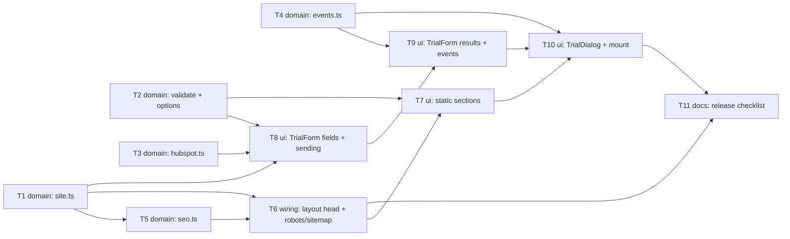

# Epic — landing-page

> **Spec:** [spec.md](../spec.md) · **Design:** [sad.md](../sad.md) · **Screens:** [screens.md](../screens.md) · **UX flows:** [ux-flows.md](../ux-flows.md) · **ADRs:** [adr/](../adr/) · **Data model / API:** none (no datastore; the only external call is the HubSpot Forms API, sliced into T3)

## Goal

Ship the sales skeleton of the Landing page at `landing.englishpusher.in.ua`: a static page with
Interim copy and one trial form window whose confirmed sends reach the existing HubSpot pipeline as
reliably as the app's (spec §2). Every Landing lead carries its entry address, everything except
the published page sends to the Test form with no analytics, and the page is ready for search and
link previews but asks not to be indexed while the copy is interim.

## Scope

- **In:** `src/lib/` pure logic (site, seo, hubspot, validate, options, events, dialog), `BaseLayout.astro` head, `robots.txt` / `sitemap.xml` routes, the static sections, the TrialForm + TrialDialog island, the `client:idle` convention update, and a release checklist for the setup and manual checks outside the code.
- **Out (spec §3):** sales content (roadmap step 3), splitting landing leads in the Leads Bot and Monday report (step 5), moving bio and post links (step 6), new lead fields, a Ukrainian version, spam protection beyond the trap field.

## Task map

Waves: **1** T1 · T2 · T3 · T4 (parallel) → **2** T5 · T8 → **3** T6 · T9 → **4** T7 → **5** T10 → **6** T11.
Lanes: T8 → T9 share `TrialForm.tsx`; T7 → T10 share `index.astro`.

## Tasks

See [tracker.md](./tracker.md) for status. Machine contract: [tasks.json](../tasks.json).

| # | Task | Layer | Blocked by | DoD (short) |
|---|---|---|---|---|
| T1 | [site.ts: live host, isPublished, form IDs, INTERIM_COPY](./t01-site-settings.md) | domain | — | host and form-ID unit tests pass; real Test form ID |
| T2 | [Copy validate.ts + options.ts, pin parity, add LinkedIn](./t02-validate-and-options.md) | domain | — | validation + field-parity tests pass |
| T3 | [Copy hubspot.ts: entry address, 15 s cut-off, failure kind](./t03-hubspot-submit.md) | domain | — | rejected / network / timeout + pageUri tests pass |
| T4 | [events.ts: three dataLayer payloads](./t04-events.md) | domain | — | exact-payload tests pass, no personal data |
| T5 | [seo.ts: robots meta, robots.txt, sitemap.xml](./t05-seo-bodies.md) | domain | T1 | interim / non-interim tests pass |
| T6 | [BaseLayout head + robots/sitemap routes](./t06-layout-head.md) | wiring | T1, T5 | build emits noindex, OG meta, robots, empty sitemap; no GTM on localhost |
| T7 | [Static sections + index.astro with Interim copy](./t07-static-sections.md) | ui | T2, T6 | two `#trial-lesson` links, no promise in copy |
| T8 | [TrialForm: fields, validation, trap field, sending](./t08-trial-form-fields.md) | ui | T1, T2, T3 | AC-02 manual check; localhost sends to Test form |
| T9 | [TrialForm: thank-you, failure banner, events](./t09-trial-form-results.md) | ui | T4, T8 | one generate_lead after 2xx; one trial_form_error per failure |
| T10 | [TrialDialog + client:idle mount](./t10-trial-dialog.md) | ui | T4, T7, T9 | dialog unit test; answers kept across openings; hash removed on close |
| T11 | [Release checklist](./t11-release-checklist.md) | docs | T6, T10 | checklist covers setup, pre-publish and E2E with AC refs |

## Risks / Hard rules

- **Only the published host is live** (ADR-0001, AC-13): exact match on `landing.englishpusher.in.ua`; never fall back to the live form ID.
- **A request counts only when HubSpot confirms it** (AC-08): `generate_lead` only after a 2xx; the trap field shows a thank-you and sends nothing.
- **Interim copy makes no promises** (AC-10) and **is never indexed** (AC-11); Tetiana approves all copy before the push to `main` that publishes it.
- **No stored answers:** typed values live only in the island's memory (sad §8 Privacy).
- **Copied code** keeps a source-path header; a HubSpot field change goes into both repos.
- **No element with `id="trial-lesson"`** (ADR-0002); the island hydrates with `client:idle`, and `CLAUDE.md` + `docs/architecture-map.md` are updated in T10.
- **Open before implementation** (spec §8, due "before `/sdd:tasks`" and still open): the Test form ID (T1 stops without it), Tetiana's LinkedIn address (T2 stops without it), whether the Leads Bot reads only the live form (blocks publishing, T11), drift detection (default applied: parity test + note).
