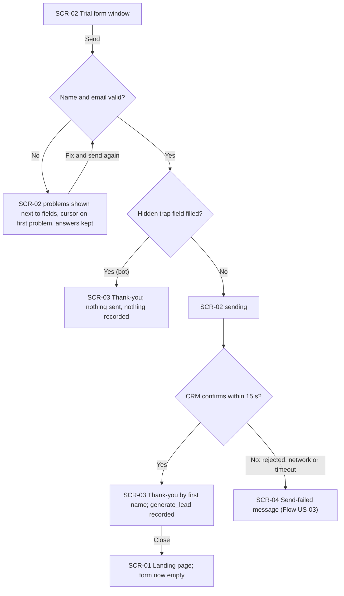
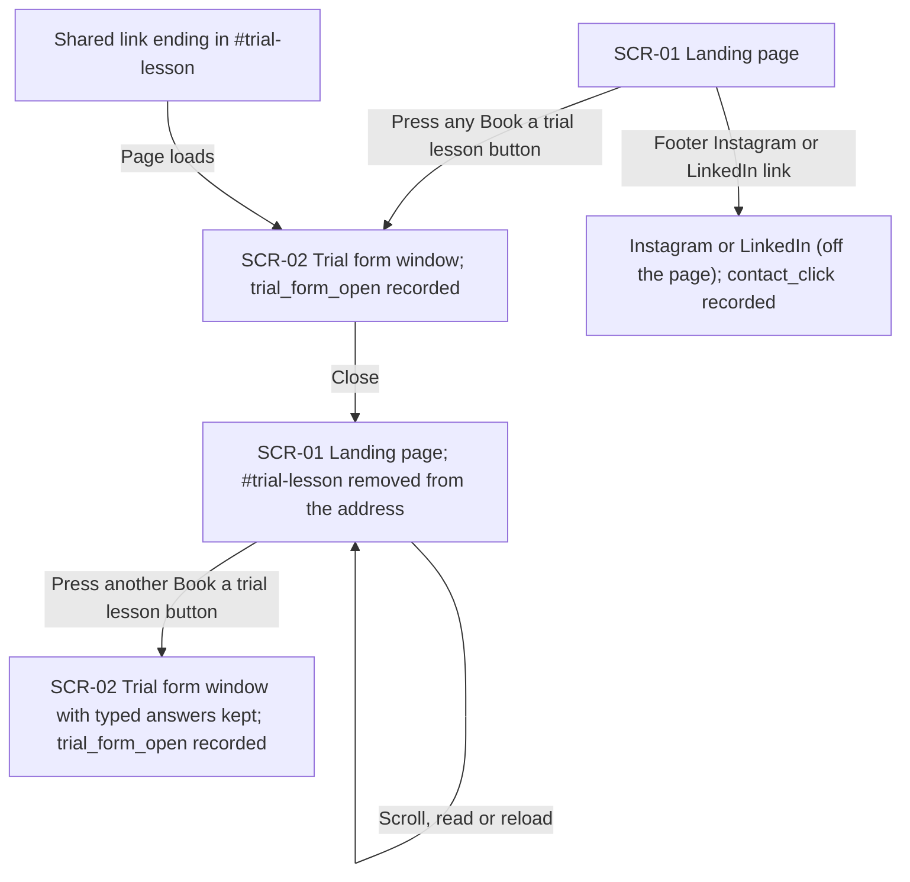
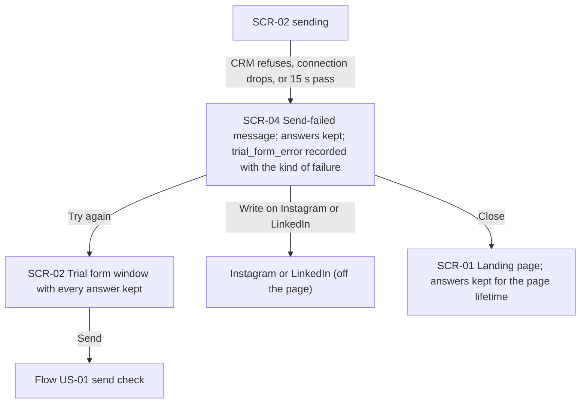
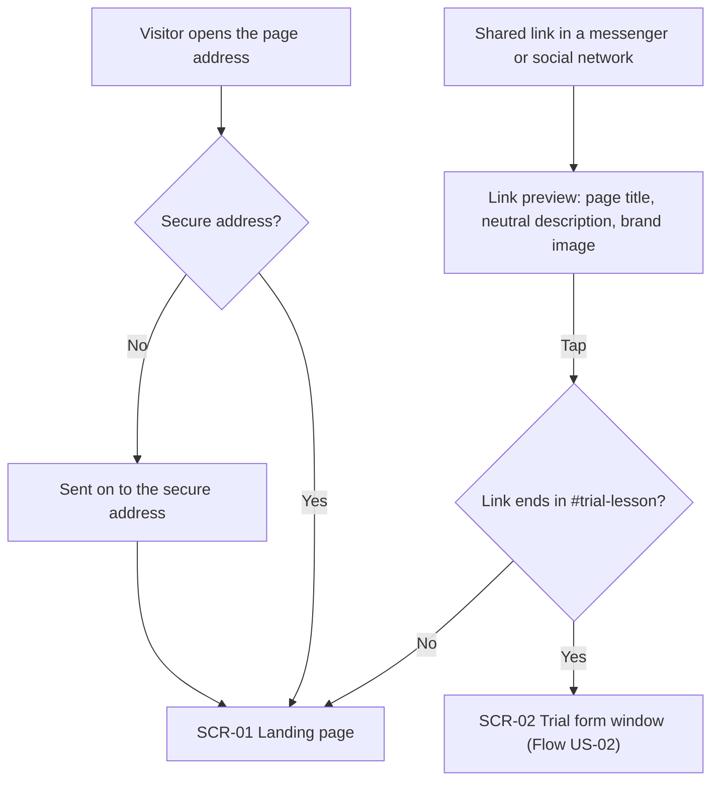

# UX flows — landing-page

> User flows for every UI-touching §4 user story, produced by `ux-flows` (after `clarify`, before
> `design`) and read by `design` (evidence for the target-surface + UI-architecture decisions),
> `sequences` (UI-driven flows align on SCR ids), `screens` (details every inventory row) and
> `plan-tests` (the e2e-through-UI paths). **Always markdown + mermaid `flowchart`**, whatever the
> design tool — this artifact is flow-altitude, not visual design.

## Platform decisions

- **Posture:** mobile-first. There is no `docs/design-system.md` yet, so this is the owner's choice
  (2026-10-31): visitors arrive mostly from Instagram and LinkedIn posts on a phone, and §6 measures
  page speed on mobile. Desktop must work too.
- **Navigation shape:** one page. Every call to action stays on the page and opens the trial form;
  the only ways off the page are the Instagram and LinkedIn links (footer and failure message).
- **Modality:** the trial form is a window over the page, as in the app (spec §1). Thank-you and
  send-failed messages are shown inside that same window, so the visitor never leaves the page.
- **Entry points:** the page address (secure or not), a shared link (with or without
  `#trial-lesson`), and the link preview in a messenger or social network.
- **Form memory:** typed answers live for the page lifetime: closing and reopening the window keeps
  them, a reload clears them, a confirmed send empties the form (AC-03).

## Screen inventory

| ID | Screen | Purpose | Entry | Exit |
|---|---|---|---|---|
| SCR-01 | Landing page | Hero, one interim block and a footer, with Interim copy; two "Book a trial lesson" buttons and the Instagram / LinkedIn links | The page address, the secure redirect, a shared link, closing the trial form window | SCR-02 (any button or `#trial-lesson`), Instagram / LinkedIn (footer links) |
| SCR-02 | Trial form window | Fill in and send the trial form; shows field problems next to the fields and a sending state | Any "Book a trial lesson" button on SCR-01, a link ending in `#trial-lesson`, "try again" on SCR-04 | SCR-03 (confirmed or trap-field send), SCR-04 (send failed), SCR-01 (close) |
| SCR-03 | Thank-you | Confirms the request and greets the visitor by first name | A confirmed send from SCR-02 (or a filled trap field) | SCR-01 (close) |
| SCR-04 | Send-failed message | Says the request did not go through, offers Instagram and LinkedIn, keeps every answer | A failed send from SCR-02 (rejected, network or timeout) | SCR-02 (try again, answers kept), Instagram / LinkedIn, SCR-01 (close) |

## Flows

### Flow: US-01 — Send a trial lesson request

The visitor fills in the form in the trial form window (SCR-02) and presses Send. If the name is
empty or the email is not a valid address, nothing is sent: the window says what is wrong next to
each problem field, puts the cursor on the first one, and keeps every other answer; the visitor
fixes it and sends again. If the hidden trap field is filled (a bot), the window shows the thank-you
(SCR-03) but nothing goes to the CRM and nothing is recorded. Otherwise the window shows that it is
sending. When the CRM confirms within 15 seconds, the window shows the thank-you with the visitor's
first name and only then records `generate_lead`; the thank-you is the same whether or not the email
was already known to the CRM (AC-09). Closing it returns to the page, and the form opens empty next
time. If the CRM refuses the send, the connection drops, or 15 seconds pass with no answer, the
visitor goes to the send-failed message (SCR-04, Flow US-03). The visitor never sees the thank-you
while a send is in progress or after it failed (AC-08).

### Flow: US-02 — Reach one form from anywhere

From anywhere on the Landing page (SCR-01), pressing either "Book a trial lesson" button opens the
one trial form window (SCR-02) and records `trial_form_open` once for that opening. A shared link
that ends in `#trial-lesson` opens the same window once, straight away, as the page loads, and
records `trial_form_open` the same way. When the visitor closes the window, `#trial-lesson` is
removed from the address and the window does not reopen by itself while they scroll, read or reload.
Opening it again from a different button shows the answers they had typed, for as long as the page
stays open. The footer links to Tetiana's Instagram and LinkedIn leave the page and record
`contact_click`.

### Flow: US-03 — Keep answers when sending fails

While the form is sending (SCR-02), the CRM refuses it, the connection drops, or 15 seconds pass
with no answer. At 15 seconds the page cancels the send and ignores any later answer. The window
switches to the send-failed message (SCR-04): it says the request did not go through and offers
links to write to Tetiana on Instagram and on LinkedIn. One `trial_form_error` event is recorded for
that attempt, naming only the kind of failure (rejected, network or timeout), and no
`generate_lead`. From there the visitor can try again, which shows the form with every answer kept
and runs the US-01 send check again; leave for Instagram or LinkedIn; or close the window and come
back later on the same page with the answers still there.

### Flow: US-07 — Own address, closed to search

A visitor who opens the Landing page's address over the secure connection lands on the page
(SCR-01); one who opens it without the secure prefix is sent on to the secure address first. A link
shared in a messenger or a social network shows a preview with the page title, a neutral description
and a brand image, all Interim copy that makes no promises. Tapping it opens the page, or, when the
link ends in `#trial-lesson`, opens the trial form window straight away (SCR-02, Flow US-02). How
search engines treat the page (AC-11) involves no visitor and is not drawn.

### Not drawn

- **US-04 — Handle landing requests as usual:** happens entirely in the CRM and the Leads Bot; no
  screen on the page.
- **US-05 — No unapproved promises:** a rule on the copy of every screen (SCR-01 to SCR-04, plus the
  link preview), not a movement between screens; covered in the AC table.
- **US-06 — Recognise and count landing leads:** nothing the visitor sees changes. Off the published
  address (AC-13) the same flows run, but sends go to the Test form and no analytics load.

## AC coverage

| AC | Shown by | Notes |
|---|---|---|
| AC-01 | Flow US-01 → Yes at "CRM confirms" → SCR-03 | `generate_lead` only after confirmation |
| AC-02 | Flow US-01 → No at "Name and email valid?" → SCR-02 problems | Loop back to send |
| AC-03 | Flow US-02 → any button → SCR-02; close → reopen with answers kept | Empty form after a confirmed send: Flow US-01 last node |
| AC-04 | Flow US-02 → shared link `#trial-lesson` → SCR-02; close removes it | Also the US-07 preview branch |
| AC-05 | Flow US-03 → SCR-04 | Try again, Instagram / LinkedIn, close |
| AC-06 | N/A: Leads Bot behaviour, no screen | US-04 not drawn |
| AC-07 | N/A: the address sent to the CRM is invisible to the visitor | Design / sequences input |
| AC-08 | Flow US-01 → trap-field branch and "sending" node | Thank-you never shown for an in-progress or failed send |
| AC-09 | Flow US-01 → SCR-03 | Same thank-you for a known email |
| AC-10 | N/A: a copy rule on SCR-01 to SCR-04 and the link preview, not a branch | US-05 not drawn; checked on the copy |
| AC-11 | N/A: search engines only, no visitor | Noted under Flow US-07 |
| AC-12 | Flow US-07 → secure redirect and link preview | |
| AC-13 | N/A: same flows off the published address, different destination | US-06 not drawn |
