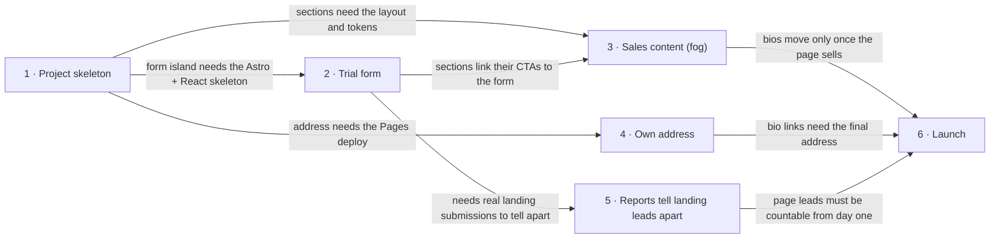

# Roadmap — landing-englishpusher

> **A decomposition, not a promise.** The overall idea broken into incremental steps: what each
> step is, where it comes from, how big it is — or that nobody has looked at it yet — and in which
> order, and parallel lanes, we walk them. **No dates** (except shipped history), **no scores** —
> order is the prioritization. The *solution* for any step lives in its `docs/features/<slug>/`
> spec, not here.

## Destination

Strangers who arrive from Tetiana's social posts, Google or a shared link reach a page at its own address that sells her lessons to IT/office professionals and general adults and turns them into trial requests in the existing HubSpot pipeline, counted as coming from that page.

## Steps

| # | Step | Source | Size | Status |
|---|---|---|:---:|---|
| 1 | Project skeleton (`scaffold`): Astro 7 + React island + Tailwind 4, BaseLayout with GTM, tests and type check, GitHub Pages deploy on the default URL | [architecture-map.md §C4 — target foundation](architecture-map.md) | S | idea |
| 2 | Trial form on the page: a visitor sends a trial request from the page into the HubSpot form "Trial lesson request" (with `hubspotutk` and page URL), and `trial_form_open` / `generate_lead` reach GTM | [idea-brief.md §5. Out of scope](idea-brief.md) (constraint to preserve) | S | shipped → [landing-page](features/landing-page/spec.md) |
| 3 | Sales content that persuades strangers → see [Not yet specified](#not-yet-specified) | [idea-brief.md §7. Recommendation](idea-brief.md) | fog | idea |
| 4 | Own address, ready for search: the page is served at its chosen address (CNAME + DNS), with canonical, Open Graph, sitemap and robots so Google can index it | [idea-brief.md §8. Open questions](idea-brief.md) (separate address) | S | shipped → [landing-page](features/landing-page/spec.md) |
| 5 | Reports tell landing leads apart: the Monday report and Leads Bot cards show which leads came from the landing page and which came from the app | [idea-brief.md §7. Recommendation](idea-brief.md) ("attributed to the page in HubSpot") | S | idea |
| 6 | Launch: Tetiana's Instagram/LinkedIn bio links and post links (with UTM tags) point to the page instead of the app | [idea-brief.md §3. Users](idea-brief.md) (how they arrive) | XS | idea |

## Not yet specified

| Area | What we'd have to learn | Blocks | How it gets sharpened |
|---|---|:---:|---|
| Sales content and positioning | Which segments and offers Tetiana leads with, the prices and formats she will publish, her story and credentials, the testimonials and photos she can supply, and whether the two segments share one page or each get their own message (brief §6 risk 3) | 3 | Conversation with Tetiana (D1), then rerun `/sdd:interview` to update the brief |

## Out of scope

- Kids/teens (parents as buyers) and exam preparation (IELTS, NMT) — owner decision: the page addresses IT/office professionals and general adults only.
- Paid advertising — not planned; traffic comes from social posts, search and word of mouth.
- Changing the Moodle site `englishpusher.in.ua` — the page lives at its own address; Moodle stays as it is.
- A new lead-capture or CRM flow — leads must keep landing in the existing HubSpot form so the Leads Bot, the deal pipeline and the Monday report keep working.

## Open decisions

| # | Question | Type | Owner | Blocks |
|---|---|:---:|:---:|:---:|
| D1 | Does Tetiana want this page, and what will she offer, price, promise and supply (story, testimonials, photos)? | grilling | human | 3 |
| D2 | Do her social posts drive clicks? A 2–3 week UTM link test to the app's `#trial-lesson` form, read in GA4 and the Monday report. Little volume means improving the app hub instead of building this page | task | human | 3 |
| D4 | Who keeps prices, availability and testimonials up to date after launch? | grilling | human | 6 |

## Decisions so far

- Address (was D3): the subdomain `landing.englishpusher.in.ua` — owner decision 2026-10-30; `cname:` in the deploy workflow and `site` in `astro.config.mjs`
- Steps 2 and 4 specified together as the "sales skeleton" before D1/D2 resolve (owner scope change 2026-10-31): English like the app, the form in a window from every CTA, and the page search-ready but asking not to be indexed until step 3's content replaces the interim copy → [`features/landing-page/spec.md`](features/landing-page/spec.md)

- Astro static site with one React island for the trial form → [`docs/adr/0001-astro-static-site-with-react-island.md`](adr/0001-astro-static-site-with-react-island.md)
- Hosted on GitHub Pages, deployed by GitHub Actions → [`docs/adr/0002-host-on-github-pages-via-actions.md`](adr/0002-host-on-github-pages-via-actions.md)
- No backend; the browser posts leads to the HubSpot Forms API → [`docs/adr/0003-no-backend-leads-via-hubspot-forms-api.md`](adr/0003-no-backend-leads-via-hubspot-forms-api.md)
- Gather evidence (Tetiana + traffic test) before specifying the content → [`docs/idea-brief.md` §7](idea-brief.md)

## Dependency graph

## Execution path

| Wave | Steps | Zone per step (why parallel-safe) | Unlocks |
|:---:|---|---|---|
| 1 | 1 | whole repo skeleton (new) | 2, 4 |
| 2 | 2 ∥ 4 | 2: `src/components/trial-form/` + `src/lib/` (new) · 4: `public/CNAME`, `astro.config.mjs` `site`, SEO meta in `src/layouts/BaseLayout.astro` (new) (disjoint) | 5 |
| 3 | 5 | n8n workflows "Weekly analytics report" + Leads Bot, outside this repo (new) | — |

Not waved yet: step 3 (fog) and step 6, which depends on it. Both get a wave once Sales content and positioning has been explored and sized.

## Shipped

| Step | Shipped | Link |
|---|---|---|
| 2 · Trial form on the page | 2026-10-31 | [changelog](features/landing-page/changelog.md) · PR: pending · live after the [release checklist](features/landing-page/release-checklist.md) |
| 4 · Own address, ready for search | 2026-10-31 | [changelog](features/landing-page/changelog.md) · PR: pending · live after the [release checklist](features/landing-page/release-checklist.md) |
